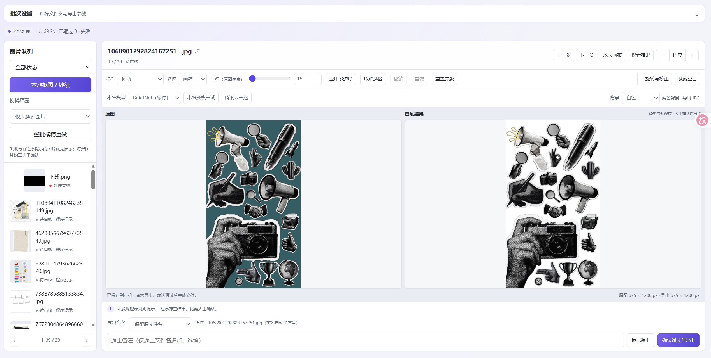

<div align="center">


# CutCut

**批量抠图，逐张修整，确认后导出。**

运行在 Mac 上的本地图片处理工作台，在浏览器中完成抠图、对照审核与人工修整。

[快速开始](#快速开始) · [功能一览](#功能一览) · [详细使用说明](使用说明.md)

</div>



*工作台实景：批量处理与逐张审核在同一页面完成，原图和结果并排对照。*

## 用 CutCut 做什么

把一批图片变成白底图或透明底素材，并在导出前逐张检查边缘、清理杂物和调整构图。适合需要保留人工审核环节的素材整理与图片处理工作。

本地抠图、修整和导出在当前 Mac 上完成；需要时，也可以使用自己的腾讯云账号对单张图片重新抠图。

## 功能一览

| 功能 | 可以做什么 |
| --- | --- |
| **本地批量抠图** | 使用 U²-Net、IS-Net 或 BiRefNet；支持停止、继续，以及整批换模型重做。 |
| **原图与结果对照** | 在同一页面切换图片、缩放和平移；其他图片仍在处理时，已完成的图片可以先审核。 |
| **手动修整** | 用画笔、套索、矩形或多边形恢复主体、擦除杂物，支持撤销、重做与重置蒙版。 |
| **裁剪与校正** | 旋转、校正、裁剪空白，选择预设比例或指定裁剪像素尺寸。 |
| **背景与导出** | 透明底导出 PNG，白色或其他纯色背景导出 JPG；保留原文件名或自定义名称，重名自动加序号。 |
| **审核与返工** | 人工确认后生成导出文件；需返工的图片可添加文件名备注，整批换模可只处理未通过图片。 |
| **腾讯云重抠（可选）** | 对单张图片生成云端候选，与本地结果比较后决定是否采用。 |

原图只读。模型结果与程序提示用于辅助处理，每张图片仍需人工确认。

## 快速开始

### 1. 准备环境

- **系统**：macOS 13 或更高版本，目前不支持 Windows。
- **Python**：3.11–3.13，需要包含 Tk 组件，用于本机文件夹选择等功能。
- **网络**：首次安装需要下载依赖；首次使用某个抠图模型时需要下载模型。

### 2. 安装并打开

1. 下载并解压**完整项目文件夹**。
2. 双击 **安装 CutCut.app**，等待环境检查与依赖安装完成。
3. 双击 **CutCut.app**，浏览器会打开本地工作台。

两个 `.app` 入口依赖项目中的程序文件，请保留在原文件夹中。如需放到桌面，可在 Finder 中右键应用选择“制作替身”，再把替身移到桌面。

应用尚未经过 Apple 签名和公证。首次打开若被 macOS 阻止，可在 Finder 中右键选择“打开”，或前往“系统设置 → 隐私与安全性”查看提示。

### 3. 处理第一批图片

1. **选择文件夹**：设置原图位置与输出位置，打开批次。建议先用 5–10 张图片试跑。
2. **生成候选**：选择模型，点击“本地抠图 / 继续”。
3. **对照修整**：逐张检查原图与结果，按需恢复主体、擦除杂物、旋转或裁剪。
4. **确认导出**：选择背景和命名方式，点击“确认通过并导出”；需要后续处理的图片可标记返工。

修整会自动保存到本机，导出文件在人工确认后生成。不同批次可以使用同一个输出文件夹，导出重名会自动避让。

**使用完毕**：在启动时打开的终端中按 `Control + C` 停止服务。只关闭浏览器页面不会停止后台服务。

## 本地处理与腾讯云重抠

**日常使用无需腾讯云账号。** 本地抠图时，图片在本机处理和保存，不会上传至云端。依赖和模型下载完成后，本地处理无需持续联网。

如需使用腾讯云重抠：

1. 自行开通腾讯云数据万象，并配置私有 COS 存储桶。
2. 在工作台的“腾讯云设置”中填写存储桶、地域和个人访问密钥。密钥保存在当前 Mac 的钥匙串中。
3. 对单张图片点击“腾讯云重抠”，确认上传后生成候选，再决定是否采用。

云端处理会上传所选原图，可能产生服务费用。正常情况下临时云文件会自动删除；清理失败时，可在设置中重试。采用云端结果会清除该图片已有的蒙版修整、裁剪及旋转校正，需要重新审核。

配置步骤、权限与尺寸限制见 [使用说明 · 腾讯云单张重抠](使用说明.md#腾讯云单张重抠可选)。

## 常见问题

<details>
<summary><strong>安装失败，或提示 Python / Tk 不可用？</strong></summary>

确认已安装带 Tk 组件的 Python 3.11–3.13，再重新打开“安装 CutCut.app”。安装程序会检查已有环境；需要修复时会备份旧环境，安装失败会自动恢复。如果上次安装被中断，再次运行安装程序即可恢复。安装前请先停止正在运行的 CutCut 服务。

</details>

<details>
<summary><strong>关掉网页后，怎么重新打开或彻底退出？</strong></summary>

再次双击“CutCut.app”会回到已运行的工作台。要彻底退出，请到启动终端按 `Control + C`。

</details>

<details>
<summary><strong>修整已经保存，为什么输出文件夹里还没有图片？</strong></summary>

修整自动保存在本机批次缓存中。点击“确认通过并导出”后，才会生成最终图片。修整已通过的图片会取消旧确认，并移除本工具生成的对应旧导出，需要重新确认。

</details>

<details>
<summary><strong>可以接着处理上一次的批次吗？</strong></summary>

可以。保留本机批次缓存，再次打开相同批次，点击“本地抠图 / 继续”会跳过已完成的候选。重启后已保存的修整仍保留，撤销历史会清空。

</details>

更多操作细节请看 [完整使用说明](使用说明.md)。

## 打包分享

在项目文件夹中打开终端，运行：

```bash
python3 prepare_release.py ~/Desktop/CutCut发布包.zip
```

脚本只打包指定的程序文件，不会覆盖已有同名文件。接收者需要自行安装依赖和下载模型。

请使用该脚本生成分享包，避免直接压缩包含个人图片、`data` 缓存或 `.venv` 环境的工作文件夹。每位使用者应配置自己的腾讯云密钥。
